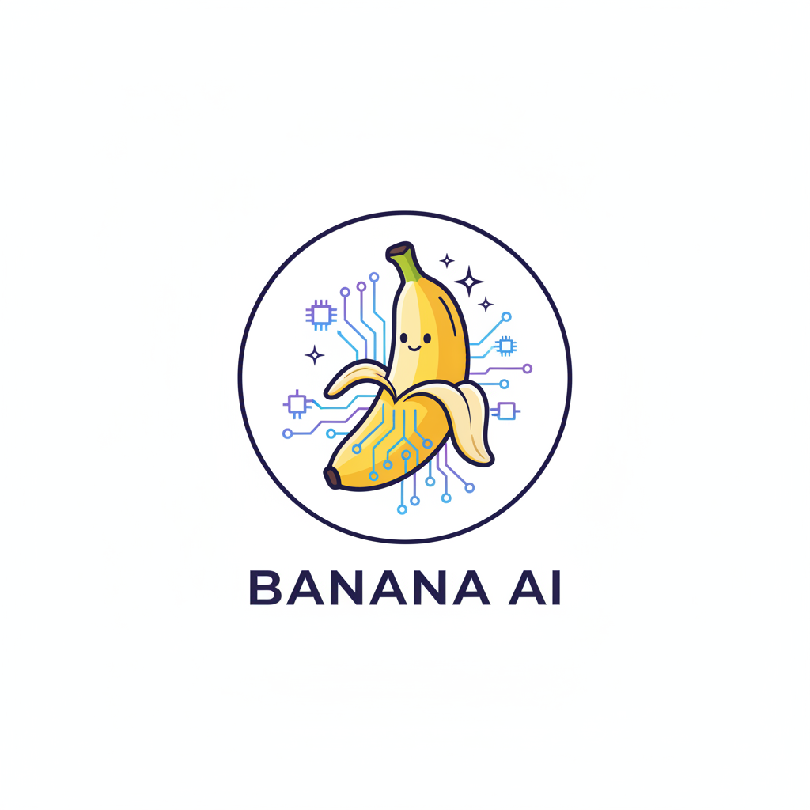
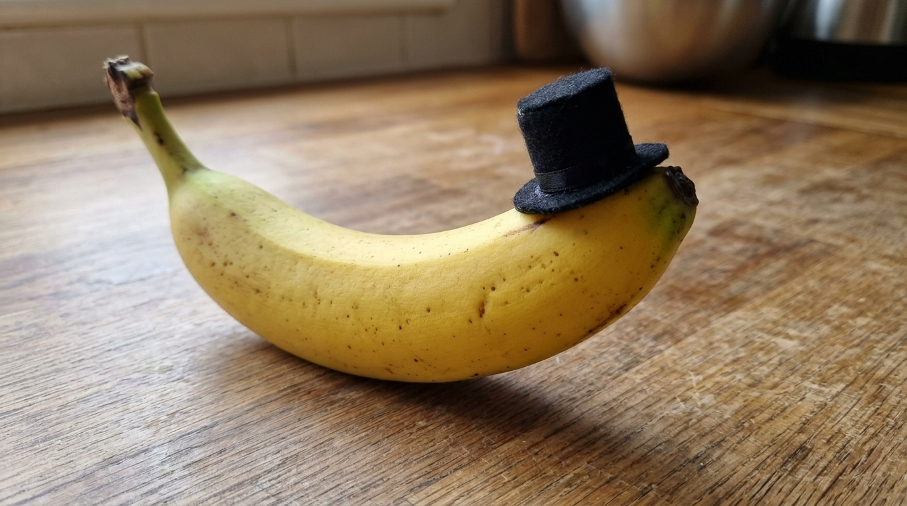
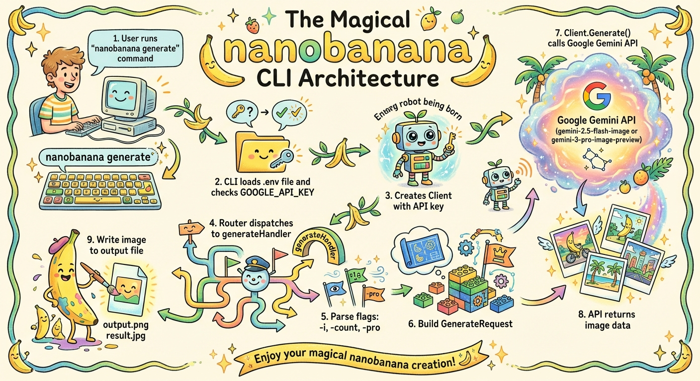

# nanobanana



[](https://pkg.go.dev/maragu.dev/nanobanana)

A Go CLI tool for generating and editing images using Nano Banana 2.1, Google's Gemini image generation model.

⚠️ THIS APP IS VIBE-CODED BY AN AI, USE AT YOUR OWN RISK! ⚠️

Made with ✨sparkles✨ by [maragu](https://www.maragu.dev/): independent software consulting for cloud-native Go apps & AI engineering.

## Installation

```bash
go install maragu.dev/nanobanana@latest
```

Or build from source:

```bash
git clone https://github.com/maragudk/nanobanana
cd nanobanana
go build
```

## Configuration

This tool uses Google's Gemini API with Nano Banana 2.1 (`gemini-nano-banana-2.1`), the newest Nano Banana model, with Flash-level speed and cost.

Set your Google API key as an environment variable:

```bash
export GOOGLE_API_KEY="your-google-api-key-here"
```

Or create a `.env` file in your working directory:

```bash
GOOGLE_API_KEY=your-google-api-key-here
```

The CLI will automatically load the `.env` file if it exists.

Get your API key from [Google AI Studio](https://aistudio.google.com/apikey).

## Supported Formats

The output is always JPEG. The output path must end in `.jpg` or `.jpeg` (in any case). Any other extension, or none, makes the CLI exit with an error before it calls the API.

If the API returns a PNG instead of a JPEG, the CLI converts it to JPEG before writing it. Transparent areas become white.

```bash
nanobanana generate image.jpg "a sunset"   # works
nanobanana generate image.jpeg "a sunset"  # works
nanobanana generate image.png "a sunset"   # error: output path must end in .jpg or .jpeg
```

Input images for editing (`-i`) can be in any format the API accepts.

## Usage

### Generate an image

Generate an image from a text prompt:

```bash
nanobanana generate output.jpg "a beautiful sunset over mountains"
```

### Edit an existing image

Edit an image using natural language instructions:

```bash
nanobanana generate -i input.png output.jpg "make the sky more purple"
```

## Examples

Prompt: "a banana wearing a tiny top hat, photorealistic"



## How it works

Here's a visual overview of how the CLI works internally:


