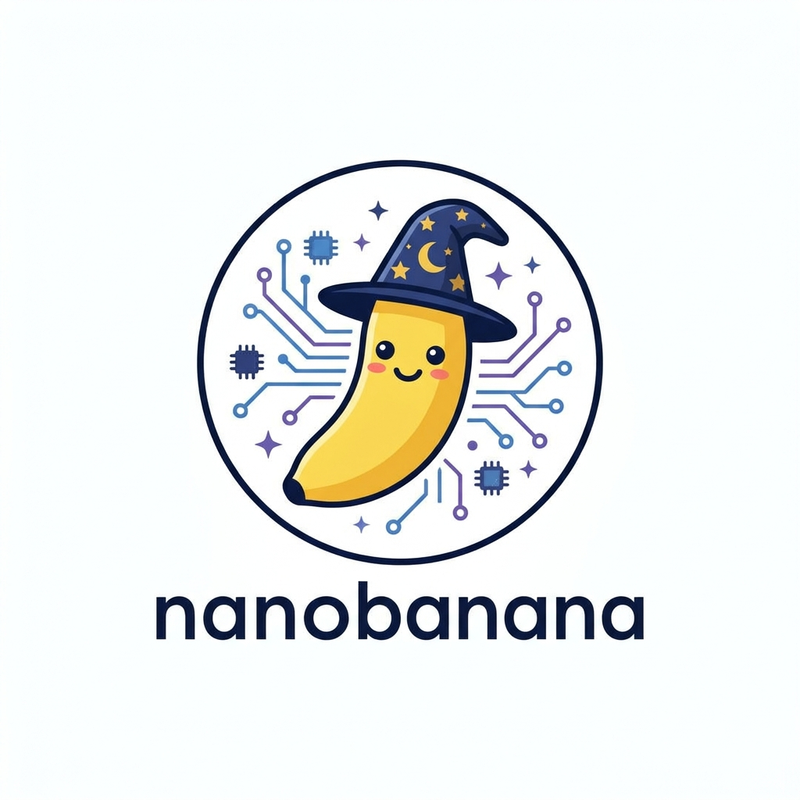
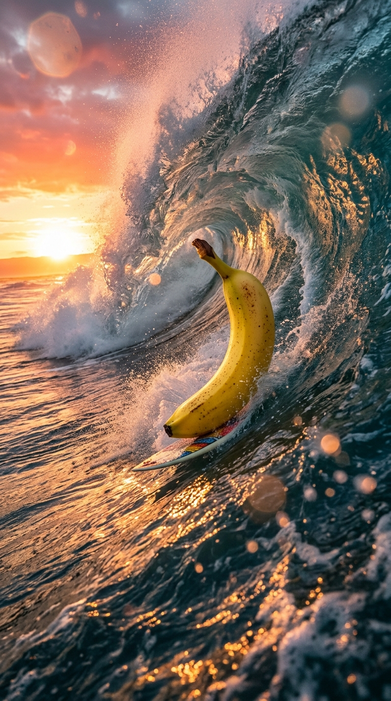
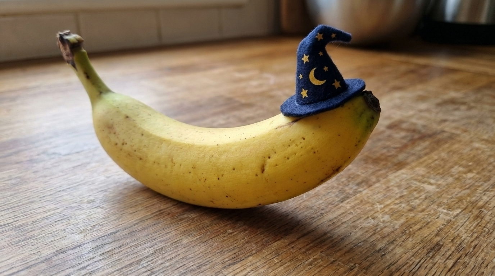
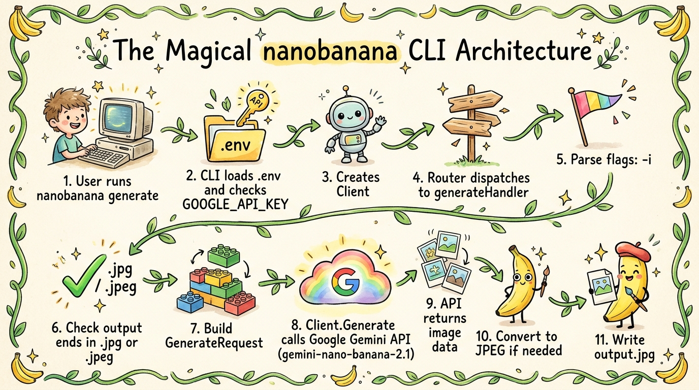

# nanobanana



[](https://pkg.go.dev/maragu.dev/nanobanana)

A Go CLI tool for generating and editing images using Nano Banana 2.1, Google's Gemini image generation model.

⚠️ THIS APP IS VIBE-CODED BY AN AI, USE AT YOUR OWN RISK! ⚠️

Made with ✨sparkles✨ by [maragu](https://www.maragu.dev/): independent software consulting for cloud-native Go apps & AI engineering.

## Installation

```bash
go install maragu.dev/nanobanana@latest
```

Or build from source:

```bash
git clone https://github.com/maragudk/nanobanana
cd nanobanana
go build
```

## Configuration

This tool uses Google's Gemini API with Nano Banana 2.1 (`gemini-nano-banana-2.1`), the newest Nano Banana model, with Flash-level speed and cost.

Set your Google API key as an environment variable:

```bash
export GOOGLE_API_KEY="your-google-api-key-here"
```

Or create a `.env` file in your working directory:

```bash
GOOGLE_API_KEY=your-google-api-key-here
```

The CLI will automatically load the `.env` file if it exists.

Get your API key from [Google AI Studio](https://aistudio.google.com/apikey).

## Supported Formats

The output format follows the extension of the output path, in any case: `.png` gives PNG, and `.jpg` or `.jpeg` gives JPEG. Any other extension, or none, makes the CLI exit with an error before it calls the API.

```bash
nanobanana generate image.png "a sunset"   # works, writes a PNG
nanobanana generate image.jpg "a sunset"   # works, writes a JPEG
nanobanana generate image.jpeg "a sunset"  # works, writes a JPEG
nanobanana generate image.webp "a sunset"  # error: output path "image.webp" must end in .png, .jpg, or .jpeg
```

The model normally returns a JPEG. If the output path asks for PNG, the CLI converts the image. The conversion is lossless, so the PNG holds the same detail as the model's JPEG, and no more. If the API returns a PNG and the output path asks for JPEG, the CLI also converts the image, and transparent areas become white.

Input images (`-i`) must be PNG, JPEG, WebP, HEIC, or HEIF. The CLI detects the format from the contents of the file, not from its extension. Any other file makes the CLI exit with an error that names the file, before it calls the API. One request can have up to 14 input images.

## Usage

```bash
nanobanana generate [flags] <output-path> <prompt>
```

Flags must come before the output path. Put the prompt in quotes. Any extra argument after the prompt, such as a flag, makes the CLI exit with a usage error.

### Generate an image

Generate an image from a text prompt:

```bash
nanobanana generate output.jpg "a beautiful sunset over mountains"
```

### Edit an existing image

Edit an image using natural language instructions:

```bash
nanobanana generate -i input.png output.jpg "make the sky more purple"
```

### Set the aspect ratio and size

Set the aspect ratio with `-aspect` and the image size with `-size`:

```bash
nanobanana generate -aspect 1:1 -size 4K logo.png "a minimalist logo of a banana"
```

`-aspect` accepts `1:1`, `1:4`, `1:8`, `2:3`, `3:2`, `3:4`, `4:1`, `4:3`, `4:5`, `5:4`, `8:1`, `9:16`, `16:9`, and `21:9`. If you leave it out, the model decides the aspect ratio.

`-size` accepts `1K`, `2K`, and `4K`, in upper or lower case. If you leave it out, the model decides the size, which is currently `1K`.

Any other value for either flag makes the CLI exit with an error that lists the allowed values, before it calls the API.

For example, `-aspect 1:1 -size 2K` gave a 2048x2048 image, `-aspect 9:16` gave 768x1376, and no flags gave 1376x768.

### Combine several images

Repeat `-i` to give the model several images:

```bash
nanobanana generate -i hat.png -i banana.jpg output.jpg "put the hat from the first image on the banana in the second"
```

The CLI sends the images in the order of the `-i` flags, so the prompt can refer to "the first image" and "the second".

The model accepts up to 14 reference images in one request: up to 10 objects and up to 4 characters. With more than 14 `-i` flags, the CLI exits with an error before it calls the API.

## Examples

Prompt: "a banana wearing a tiny top hat, photorealistic"


### Aspect ratio

A portrait image, 768x1376 pixels:

```bash
nanobanana generate -aspect 9:16 banana-surfing.jpg "a banana surfing a towering wave at sunset, photorealistic"
```



### Multiple images

The wizard hat from the logo, on the banana from the first example. Both input images are in this repository:

```bash
nanobanana generate -i logo.jpg -i examples/nano-banana-2.1.jpg wizard-hat.jpg "put the wizard hat from the first image on the banana in the second"
```

| First input: `logo.jpg` | Second input: `examples/nano-banana-2.1.jpg` |
| --- | --- |
|  |  |

Result:



## How it works

Here's a visual overview of how the CLI works internally:


